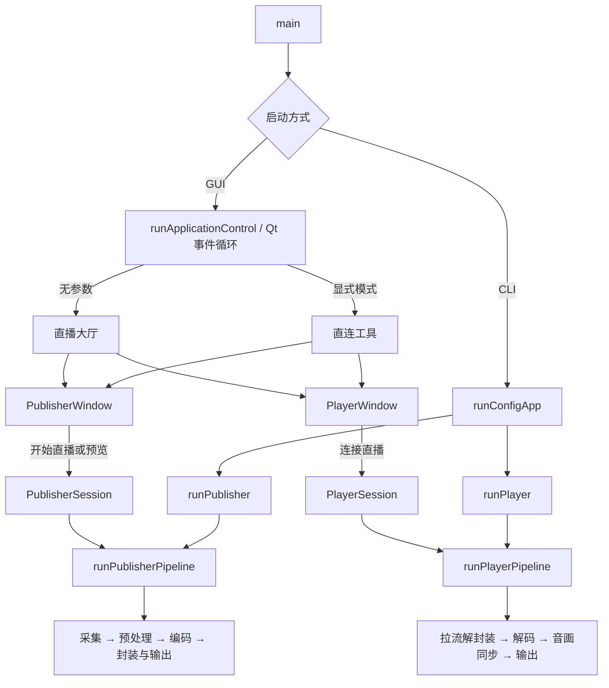

# 当前项目函数调用顺序

本文以 2026-10-28 的源码和 `D:/直播/方案.md` 为基础，GUI 入口与退出部分已按统一直播大厅更新。

覆盖自有代码中的入口、配置、界面事件、会话、采集、编解码、封装、网络、同步与退出路径。FFmpeg、SDL、Qt 内部实现不继续展开；纯样式、图标和文字格式化函数作为界面叶子函数说明。

## 1. 先理解调用顺序

- `→` 表示同一调用链中的先后调用。
- `⇒ 队列 ⇒` 表示生产者和消费者之间的数据交接，不是同一线程中的函数嵌套。
- 回调由事件或后台进度触发，不是启动时全部执行一遍。
- 线程的创建顺序不代表线程运行期间的全局先后顺序。音视频会并行处理，再通过时间戳和队列协调。
- `Session::start()` 启动后台工作后返回；`requestStop()` 发出停止请求，实际资源回收由后台和析构完成。



## 2. 唯一程序入口

入口：`src/apps/livestreamlab_main.cpp:72`。

```text
main(argc, argv)
  → config::commandLineArguments(argc, argv)
      Windows：GetCommandLineW → CommandLineToArgvW → UTF-8 参数
  → parseLaunchOptions(args)
      提取 --mode publisher|player、--cli，保留其余配置参数
  → 分支
      ├─ 无 mode、无参数：runApplicationControl({}, {})
      ├─ 仅 --help：printHelp() → 返回
      ├─ 缺 mode 却带媒体参数/--cli：抛出 ConfigError
      └─ 有 mode：parseCommandLine(mode, arguments)
           ├─ GUI 构建、未指定 --cli、非查询命令
           │    → runApplicationControl(mode, arguments)
           └─ CLI 或帮助/配置/设备查询
                → runConfigApp(mode, arguments, runPublisher, runPlayer)
```

当前顶层 CMake 只生成统一应用 `livestreamlab`。`publisher` 和 `player` 是两个业务模块，不是当前的两个独立程序入口。`LSL_BUILD_GUI=OFF` 时，指定模式后直接走 CLI。

### 2.1 GUI 的创建顺序

位置见 [ApplicationControl.cpp](../src/apps/ui/ApplicationControl.cpp) 和 [LobbyControl.cpp](../src/apps/ui/LobbyControl.cpp)。

```text
runApplicationControl(initialMode, arguments)
  → 创建唯一 QApplication
  → 设置应用名和退出策略
  → applyTheme()
  → 创建 ApplicationWindows
  → 无初始模式：openLobby() → 加载平台和观众配置 → 创建大厅
  → 有初始模式：openDirect() → 合并对应配置和参数 → 创建直连工具
  → app.exec()：进入 Qt 事件循环
```

```text
大厅显示 → 匿名查询公开直播列表
  → 选择房间：查询播放地址 → 创建平台播放器 → 自动连接
  → 我要开播：创建平台主播窗口 → 登录或复用当前登录态 → 打开个人房间
      → 用户开始直播后申请直播场次、启动推流
  → 子窗口打开时隐藏大厅并取消大厅查询，关闭后恢复列表刷新
```

默认 GUI 配置是程序目录旁的 `config/player.json` 和 `config/publisher-stream.json`。直连 GUI 支持用 `--config` 和其他命令行参数覆盖。

### 2.2 CLI 与配置加载顺序

位置：`src/common/config/CommandLine.cpp:291`、`src/common/config/Config.cpp:394`。

```text
runConfigApp()
  → parseCommandLine()                          CommandLine.cpp:300
  → help：commandLineHelp() → 输出并返回
  → loadPublisherConfig() / loadPlayerConfig()
      → 有文件：readFile()；无文件：使用 "{}"
      → parsePublisherConfig() / parsePlayerConfig()
          → document(默认配置)
          → parse(文件 JSON)
          → merge(默认配置, 文件配置)
          → applyOverrides(命令行覆盖项)
          → 转换成配置结构体
          → validate(config)
  → toJson(config)：再次校验并生成展示文本
  → 创建 Logger → 记录启动日志
  → printConfig/checkConfig：输出并返回
  → 根据 mode 调用 action：runPublisher() 或 runPlayer()
```

直连 GUI 与 CLI 共用配置加载逻辑，优先级为 **结构体默认值 → 配置文件 → 命令行覆盖**。

当前 CLI 在 `main()` 和 `runConfigApp()` 中分别解析一次选项；这两次解析都不创建媒体线程。设备查询由 `runPublisher()` 处理并返回，不进入完整媒体流水线。

## 3. 主播界面的事件调用

### 3.1 创建窗口

位置：`src/publisher/ui/PublisherControl.cpp:307`。

```text
createPublisherControl()                        :770
  → PublisherWindow 构造
      → 构造 PublisherSession（尚未启动采集）
      → Logger::enableMemoryLog(512)
      → buildSidebar()
      → buildStudio()
      → buildSettings()
      → buildFooter()
      → connectControls()
      → refreshDevices()
          → fillDevices(Video) → capture::listDevices(Video)
          → fillAudioSources() → capture::listDevices(Audio)
          → updateSourceDetails()
      → updateSourceDetails()
      → updateOutputSummary()
      → 创建 100 ms QTimer → pollSafely()
      → poll()
```

`refreshDevices()` 会枚举设备；真正打开采集设备要等用户点击预览或开播。

### 3.2 开播、预览与停止

```text
开始直播按钮
  → startLive()                                :646
      → formConfig() → config::validate()
      → 普通待机：clearPreview() → session_.start(config)
      → 正在预览：保存 pendingLive_ → session_.requestStop()
          → 后续 poll() 看到 Stopped
          → clearPreview() → session_.start(正式推流配置)
      → poll()

预览按钮
  → togglePreview()                            :658
      → 已在预览：session_.requestStop()
      → 待机：clearPreview() → session_.startPreview(formConfig())
      → poll()

停止按钮
  → session_.requestStop() → pollSafely()
```

`formConfig()` 将 GUI 选择整理为设备实时采集配置，启用音视频和推流，并清空本地视频/音频文件路径。预览由 Session 再改为仅视频、禁用推流和本地录制。**预览仍进入现有处理/编码流水线，并不是单独的“只采集不编码”实现。**

### 3.3 定时刷新、预览画面与状态回传

```text
QTimer::timeout（100 ms）
  → pollSafely()                               :677
      → poll()                                 :711
          → session_.snapshot()
          → 如预览已停止，处理 pendingLive_
          → 更新按钮、连接状态、时长和提示
          → updateStats(snapshot)
          → updatePreviewAndLogs()             :667
              → session_.preview()
              → 若有新 sequence：构造 QImage 并 copy()
              → PreviewWidget::setFrame() → update()
                  → Qt 稍后触发 PreviewWidget::paintEvent()
              → logger_.linesSince() → 追加日志
          → 如正在关窗且会话已结束：close()
```

预览数据反向路径是：视频工作线程 `PreviewConverter::publish()` → `PublisherSession::observePreview()` → 最新帧快照 → Qt 定时读取。统计由协调线程回调 `PublisherSession::observe()` 后发布给 UI。

## 4. 主播 Session 与媒体流水线

### 4.1 Session 负责生命周期

位置：`src/publisher/pipeline/PublisherSession.cpp:26`。

```text
PublisherSession::start(config)                 :231
  → Impl::start(config, false)                  :26
      → 若仍在运行则返回 false
      → join 上次已结束的 worker
      → 复制配置 → validate()
      → 重置快照、停止标志、预览和统计基准，状态 Starting
      → std::thread
          → Impl::run(config)                  :165
              → runPublisherPipeline(config, logger, stop,
                    stats → observe(stats),
                    preview → observePreview(frame))
              → 正常返回：finish(nullptr)
                异常：finish(error)
```

`startPreview()` 调用相同的 `Impl::start(config, true)`，在校验前修改为设备视频、禁用音频/推流/录制。

`observe()` 更新状态和速率快照；`observePreview()` 只替换最新预览；`snapshot()` / `preview()` 供 UI 读取，均不驱动媒体线程。

CLI 则是 `runPublisher()`（`PublisherPipeline.cpp:245`）先处理 `listDevices` / `printDeviceOptions` 查询；正常运行时创建 `SignalScope`，调用同一 `runPublisherPipeline()`，不经过 GUI Session。

### 4.2 初始化与线程创建的准确顺序

位置：`src/publisher/pipeline/PublisherPipeline.cpp:273`。

```text
runPublisherPipeline()
  → 创建 videoFrames、audioFrames、output 三个有界队列
  → 确定实时模式与共用时间起点 originUs
  → 创建输入对象
      文件：一个 MediaInput
      设备：启用的视频/音频各一个 MediaInput
  → 若启用推流：创建 RtmpPublisher（此时尚未连接）
  → 定义 stopAll / recordFailure / joinAll / 统计等协调函数
  → launch(输出事件线程)                        :513
  → launch(视频处理/编码线程)                   :568
  → launch(音频处理/编码线程)                   :637
  → 设备模式先向 output 放 Start 事件           :715
  → 为各输入 launch(采集线程)                  :724
  → 协调循环                                   :793
      检查停止、streaming->checkError()
      定期 reportStats() / reportQueues()
  → joinAll() → 最终统计 → 返回
```

文件输入在打开文件、确认实际音视频轨道之后再发送 `Start`。线程启动后，音视频参数谁先产生、谁先入输出队列没有固定顺序。

### 4.3 采集线程：设备和文件的分支

位置：`PublisherPipeline.cpp:725`。

```text
采集线程
  → MediaInput::openFile(config) 或 openDevice(kind, config)
  → 循环 MediaInput::readFrame()
      → 得到 CapturedFrame（kind、frame、timestampUs）
      → 音频：audioFrames.push()
      → 非实时视频：videoFrames.push()
      → 实时视频：videoFrames.tryPush()
          队满：tryPop() 移除最旧原始帧 → 重试 tryPush()
  → MediaInput::close()
  → closeQueues()：关闭本输入负责的原始帧队列
```

`MediaInput` 内部（`src/publisher/capture/MediaInput.cpp`）：

| 接口/分支 | 内部调用顺序 |
|---|---|
| `openDevice()`，桌面 | `openDesktop()` → 配置 `ddagrab`（首个显示输出、鼠标、帧率）→ 连接并配置 FFmpeg 采集图 |
| `openDevice()`，系统音频 | `SystemAudioInput::open()` → 打开 WASAPI 默认播放端点回采并启动客户端 |
| `openDevice()`，摄像头/麦克风 | `deviceFormat()` → `deviceUrl()` → 输入参数 → `Impl::open()` → `addDecoder(kind)` |
| `openFile()` | `Impl::open()` → 探测流信息 → 为实际存在且允许的轨道 `addDecoder()` → 计算媒体起点 |
| `Impl::open()` | 分配输入上下文 → 安装可取消中断回调 → `avformat_open_input()`；文件还会探测流信息 |
| `addDecoder()` | 查找流/解码器 → 拷贝 codec 参数 → 设置时间基 → `avcodec_open2()` |

```text
MediaInput::readFrame()
  ├─ 系统音频：SystemAudioInput::readFrame(stop)
  ├─ 桌面：从 ddagrab 采集图取得 D3D11 帧 → 下载到 CPU BGRA → 返回 CapturedFrame
  └─ 其他输入：Impl::read()
       → 先尝试 avcodec_receive_frame()
           成功：stamp() → 返回 CapturedFrame
       → 有待发送包：avcodec_send_packet()
       → 否则 readPacket() → av_read_frame()
       → 文件 EOF：送空包，排空输入解码器
           loop：rewind() → 继续
           非 loop：返回 nullopt
```

`stamp()` 统一采集和文件时间轴，文件实时模式会按媒体时间控制读取节奏。设备视频还调用 `stampCaptureTime()` 写入采集系统时间。

桌面读取遇到可恢复错误时，采集线程在超时预算内尝试重建 `ddagrab` 采集图，音频和后续流水线继续使用原来的会话。

系统音频（`src/publisher/capture/SystemAudioInput.cpp:264`）的读取链为：`GetNextPacketSize()` → `GetBuffer()` → 复制 PCM/处理静音 → 释放 WASAPI buffer → 时钟换算 → `swr_convert()` → 返回音频 `CapturedFrame`；停止时可排出 `drainTail()`。

### 4.4 视频处理与编码线程

位置：`PublisherPipeline.cpp:568`。

```text
videoFrames.pop(raw)
  → 实时模式检查原始帧时效，必要时丢弃过旧帧
  → 首帧：创建 VideoPreprocessor(videoOptions(config), originUs)
  → VideoPreprocessor::process(frame, timestampUs)
  → consume(processedFrames)
      → 每个输出帧：PreviewConverter::publish(frame)
      → 第一个输出帧：创建 VideoEncoder(encoderOptions(config, frame))
          → sendParameters(Video, parameters(), timeBase())
      → VideoEncoder::encode(frame)
      → sendPackets(Video, packets)
          ⇒ output 中的 Packet 事件
```

注意：视频编码器依据第一个预处理输出帧才创建，不是在流水线入口立即创建。

视频预处理（`src/publisher/preprocess/VideoPreprocessor.cpp:444`）：

```text
process()
  → validateInput()
  → ptsFor(timestampUs)
  → 重复/回退 PTS：丢弃
  → prepare(frame)
      → 按输入帧 crop 元数据应用可见区域裁剪
      → colors() / geometry()
      → 引用兼容帧或 sws_scale() 转换、缩放
      → 可选 transform()：旋转/镜像
      → clearGeometrySideData()
      → 可选 drawText()：文字水印
  → 需要补帧时 outputFrame(previous, pts)
  → outputFrame(current, pts)
      → referenceFrame()
      → 设置 PTS / time_base / duration
      → 可选经过时间叠加
```

`PreviewConverter::publish()`（`PublisherPipeline.cpp:183`）约每 125 ms 最多发布一帧 RGB24 副本，供 GUI 最新帧预览。

视频编码（`src/publisher/encoder/VideoEncoder.cpp:186`）：

```text
encode()
  → validateFrame() → referenceFrame()
  → Impl::send() → avcodec_send_frame()
      EAGAIN：receive() → 重送同一帧
  → Impl::receive() → 循环 avcodec_receive_packet()
  → 返回零个、一个或多个独占 PacketPtr
```

### 4.5 音频处理与编码线程

位置：`PublisherPipeline.cpp:637`。

```text
audioFrames.pop(raw)
  → 统计输入 PCM 电平
  → 首帧：创建 AudioEncoder(audioEncoderOptions(config))
  → 读取 AAC 编码器实际格式、采样率、声道数、frameSize
  → 创建 AudioPreprocessor(audioOptions(config, encoder), originUs)
  → AudioPreprocessor::process(frame, timestampUs)
  → consume(processedFrames)
      → 统计输出 PCM 电平
      → 第一个可编码帧：sendParameters(Audio, parameters(), timeBase())
      → AudioEncoder::encode(frame)
      → sendPackets(Audio, packets)
          ⇒ output 中的 Packet 事件
```

这里是**先打开音频编码器，再按编码器实际接受的参数创建音频预处理器**。

音频预处理（`src/publisher/preprocess/AudioPreprocessor.cpp:294`）：

```text
process()
  → 校验样本、格式与声道布局
  → sourcePts() / expectedInputPts()
  → 处理时间跳变、格式变化
      → 必要时 drainResampler()
      → 小缺口 appendSilence()；大缺口 finishFifo()
      → 重叠时跳过已覆盖的输入样本
  → 必要时 configureResampler()
  → 分块 swr_convert()
  → applyGain()
  → appendSamples() → 写 FIFO → emitReady()
      → emitSamples(frameSize)
      → 设置累计样本 PTS，输出编码用 AVFrame
```

`AudioEncoder::encode()`（`src/publisher/encoder/AudioEncoder.cpp:225`）同样调用 `validateFrame()` → `referenceFrame()` → `send()` → `receive()`。

### 4.6 输出事件线程

位置：`PublisherPipeline.cpp:513`。按 `output.pop(event)` 的实际到达顺序执行：

| 事件 | 下游函数 |
|---|---|
| `Start` | 若推流开启，`RtmpPublisher::start(video, audio)` |
| 视频 `Parameters` | `setVideoParameters()`；如启用本地视频文件，构造 `VideoFileWriter` |
| 音频 `Parameters` | `setAudioParameters()`；如启用本地音频文件，构造 `AudioFileWriter` |
| 视频 `Packet` | 可选 `submitVideo()`，随后可选 `VideoFileWriter::write()` |
| 音频 `Packet` | 可选 `submitAudio()`，随后可选 `AudioFileWriter::write()` |
| 视频 `End` | 可选 `VideoFileWriter::finish()`，随后 `finishVideo()` |
| 音频 `End` | 可选 `AudioFileWriter::finish()`，随后 `finishAudio()` |
| 事件队列排空 | 可选 `RtmpPublisher::finish()` |

一条轨道的编码参数先于它的首包，`End` 后于它的所有尾包；音视频轨之间则交错到达。

同时推流和本地录制时，用 `referencePacket()` 为网络支路建立独立的包结构，避免两个写出路径修改同一 `AVPacket`。

本地写出器（`src/publisher/muxer/VideoFileWriter.cpp:35`、`AudioFileWriter.cpp:31`）：

```text
构造 → 准备路径 → 分配输出容器 → 建轨/复制参数 → 打开文件 → 写文件头
write(packet) → 换算时间基 → av_interleaved_write_frame()
finish() → av_write_trailer() → 关闭文件
```

当前本地输出是独立的视频 MP4 和音频 M4A 文件。GUI 的开播表单默认禁用这两个文件路径。

### 4.7 RTMP 网络线程

位置：`src/publisher/rtmp/RtmpPublisher.cpp`。

```text
RtmpPublisher::start()                          :653
  → 登记启用轨道 → 启动网络 worker
      → Impl::run()                            :576
          → take(item, index)                  :388
              → 等所有启用轨道的编码参数
              → 有视频时等可解码关键帧
              → 比较 DTS，选择音频或视频包
          → 若尚无上下文：openSession()         :318
              → 分配 FLV 上下文
              → 建音视频流、拷贝参数
              → avio_open2()：建立 RTMP/RTMPS 连接
              → avformat_write_header()
          → write(item, index)                 :486
              → 统一时间起点 → 换算 PTS/DTS
              → av_interleaved_write_frame()
          → 重复 take() → write()
          → 正常结束：closeSession(true)
```

上游 `submitVideo()` / `submitAudio()` → `submit()`（`:226`）只交接编码包。实际网络 I/O 由这个网络线程独占。

重连分支：`take/openSession/write` 发生可恢复网络错误 → `recover()`（`:530`）→ 清积压、记录错误 → 标记 Reconnecting → `closeSession(false)` → 可取消的指数退避 → 等新关键帧 → `openSession()` 建立新 FLV/RTMP 会话。

网络包队列溢出时会清理积压、更新 generation 并等待关键帧恢复。不可恢复错误或重试耗尽后，worker 保存错误，由流水线协调线程的 `checkError()` 抛出。

## 5. 观众界面的事件调用

位置：`src/player/ui/PlayerControl.cpp`。

```text
createPlayerControl()                          :576
  → PlayerWindow 构造                          :274
      → 构造 PlayerSession（尚未拉流）
      → enableMemoryLog(512)
      → 创建地址栏、VideoSurface、控制与统计/日志控件
      → VideoSurface::presented 回调绑定到 session_.notePresented()
      → connectControls() → updateSoundControls()
      → 创建 16 ms QTimer → pollSafely()
      → poll()
```

### 5.1 连接和播放控制

```text
连接按钮 / 地址栏回车
  → connectStream()                            :449
      → formConfig() → config::validate()
      → video_->clearFrame()
      → session_.start(config)
      → poll()

停止按钮 → session_.requestStop() → pollSafely()
暂停按钮 → session_.setPaused(value) → updateSoundControls()
静音按钮 → session_.setMuted(value) → updateSoundControls()
音量滑块 → session_.setVolume(value)
全屏按钮 / 双击 / 快捷键 → toggleFullscreen()
```

Session 的 `setPaused()` / `setMuted()` / `setVolume()` 更新期望控制及 revision；后台协调循环随后读取并作用到音频输出和同步器。全屏由 Qt 窗口处理。

### 5.2 GUI 显示和绘制回报

```text
QTimer::timeout（16 ms）
  → pollSafely() → poll()                      :462 / :501
      → 必要时 SDL_PollEvent() 泵送音频相关事件
      → session_.snapshot()
      → 更新按钮、状态、音量、时间和统计
      → frameRevision 变化时：session_.frame()
          → QImage(...).copy()
          → VideoSurface::setFrame() → update()
      → 每约 100 ms：logger_.linesSince() → 追加日志
      → 关窗且会话已结束时：close()
  → Qt 随后触发 VideoSurface::paintEvent()      :175
      → QPainter::drawImage()
      → 对首次绘制的新 sequence 调用 presented 回调
          → session_.notePresented(sequence, capturedUnixUs)
```

因此 GUI 视频路径中的后台 `render()` 仅生成 RGB 最新帧，真正的 Qt 绘制发生在主线程。端到端延迟样本在绘制完成回报时更新，不以后台生成 RGB 的时刻冒充界面绘制完成。

## 6. 观众 Session 与播放流水线

### 6.1 GUI 与 CLI 的入口差异

GUI（`src/player/pipeline/PlayerSession.cpp:106`）：

```text
PlayerSession::start(config)
  → Impl::start(config)
      → 检查运行状态和调用线程必须为应用主线程
      → join 旧 worker → 释放旧 audioOutput
      → 复制配置 → validate()
      → createPlayerAudioSink()：在应用主线程初始化 SDL AUDIO
      → 重置状态、控制、停止标志、最新画面
      → std::thread
          → Impl::run()                        :261
              → 构造 MailboxRenderer
              → runPlayerPipeline(...,
                    状态回调 → observe(),
                    控制读取 → controls())
              → finish(nullptr/错误)
```

CLI（`src/player/pipeline/PlayerPipeline.cpp:222`）：

```text
runPlayer()
  → SignalScope
  → SDLVideoRenderer 构造：在主线程创建视频窗口
  → createPlayerAudioSink()
  → runPlayerPipeline()
```

GUI 在 Session 后台线程运行播放核心，Qt 主线程负责绘制；CLI 在应用主线程运行播放核心并调用 SDL 渲染。启用音频时，`createPlayerAudioSink()`（`:208`）创建 `SDLAudioSink`，实际音轨设备流在收到音轨 Reset 后打开。

### 6.2 核心初始化顺序

位置：`src/player/pipeline/PlayerPipeline.cpp:233`。

```text
runPlayerPipeline()
  → 检查停止标志
  → 构造 Demuxer
  → 构造 VideoFrameQueue
  → 构造 Shutdown：异常/退出兜底
  → input.start()                              :265，启动网络线程
  → 构造 VideoWorker                          :266，启动视频解码线程
  → 构造 AudioPlayback                        :267，启动音频解码线程
  → 构造 AVSynchronizer
  → 进入协调循环                               :345
```

从这里开始，有网络、视频解码、音频解码、协调循环，以及 SDL 音频回调等多个执行主体。

### 6.3 网络解封装与包缓冲

位置：`src/player/demuxer/Demuxer.cpp`。

```text
Demuxer::start()                              :395
  → worker → Impl::run()                     :296
      → open()                               :165
          → avformat_alloc_context()
          → 设置超时/停止 interrupt 回调与 FLV 参数
          → avformat_open_input()
          → avformat_find_stream_info()
          → findTrack(Video) / findTrack(Audio)
          → buffer.reset(streams)
              清旧包、更新 serial、准备两路 Reset 事件
          → connection.connected()
      → readUntilEof()                        :216
          → 循环 av_read_frame()
          → 判断轨道、过滤损坏/空包
          → packetTime() 换算时间
          → 时间戳异常时 buffer.invalidate()
          → buffer.push(Video 或 Audio)
          → 记录吞吐和媒体进度
```

`PacketBuffer`（`src/player/demuxer/PacketBuffer.cpp`）保存压缩包：`push()` 在 `:179`，`pop()` 在 `:225`。每路消费顺序是：**Reset → 同 serial 的 Packet → 排空后的 End**；停止时返回 Stopped。

溢出、过期、断线或同步失效会清两路缓冲、切换 serial，并在有视频时等待关键帧。压缩包队列与解码后 `VideoFrameQueue` 是不同层次。

### 6.4 视频解码线程

位置：`PlayerPipeline.cpp:50`。

```text
VideoWorker 构造 → thread → run()
  → 构造 VideoDecoder
  → 循环 input.pop(Video)
      ├─ Reset
      │    → frames.reset(serial)
      │    → decoder.reset(track, serial)
      ├─ Packet
      │    → decoder.decode(packet, serial)
      │    → publish(decodedFrames)
      │        → VideoFrameQueue::push()
      ├─ End
      │    → input.checkError()
      │    → decoder.flush()
      │    → publish(尾帧)
      │    → frames.finish()
      └─ Stopped → 退出
```

解码内部（`src/player/decoder/VideoDecoder.cpp`）：

```text
reset()                                      :297
  → 释放旧上下文，按新轨道参数创建/打开解码器

decode()                                     :332
  → send()                                   :262
      → avcodec_send_packet()
      → EAGAIN 时 receive() 后重送原包
  → receive()                                :213
      → avcodec_receive_frame()
      → best_effort_timestamp / PTS 换算微秒
      → duration()
      → adapt()                              :153
          裁剪；YUV420P/NV12 可直通，其余按需转换
      → 生成带 serial / timestampUs / durationUs 的 DecodedVideoFrame
```

`VideoFrameQueue::push()`（`VideoFrameQueue.hpp:48`）满时背压解码线程；协调循环的 `pop()`（`:67`）不阻塞等待。serial 换代和停止会打断生产者等待，迟到帧由同步器决定是否丢弃。

### 6.5 音频解码、PCM 环和设备回调

位置：`src/player/pipeline/AudioPlayback.cpp:68`。

```text
AudioPlayback 构造 → Impl 构造 → worker → run()
  → 构造 AudioDecoder
  → 循环 input.pop(Audio)
      ├─ Reset
      │    → AudioDecoder::reset()
      │    → SDLAudioSink::reset()
      │        → changeEpoch()：清旧 PCM、SDL 缓冲和时钟
      │        → ensureOpen() → selectDevice()
      │            → SDL_OpenAudioDeviceStream(..., fill, this)
      │        → SDL_ResumeAudioStreamDevice()
      ├─ Packet
      │    → AudioDecoder::decode()
      │    → AudioPlayback::publish()
      │        → sink->enqueue(block) ⇒ 有界 SPSC PCM 环
      │        → 满时短等并检查 stop / serial
      ├─ End
      │    → input.checkError()
      │    → decoder.flush() → publish(剩余 PCM)
      │    → sink->finish()
      └─ Stopped → 退出
```

禁用音频时没有实际 sink，但仍及时消费音频包，避免拉流缓冲持续积压。

音频解码内部（`src/player/decoder/AudioDecoder.cpp`）：

```text
decode()                                     :373
  → send() / avcodec_send_packet()            :313
  → receive() / avcodec_receive_frame()       :292
  → convert()                                :212
      → configure()：按需创建重采样器           :190
      → swr_convert()
      → append()：生成交错 float32 PCM 块      :148
```

另一个执行主体是 **SDL 音频线程主动调用回调**（`src/player/audio/SDLAudioSink.cpp:252`）：

```text
SDLAudioSink::Impl::fill()
  → 从预分配 PCM 环读取样本
  → SDL_PutAudioStreamData()
  → 更新媒体样本提交位置
  → SDL / 系统音频设备输出
```

不是解码线程逐次直接调用 `fill()`。`clock()`（`:547`）→ `estimateClock()`（`:191`）按提交位置、SDL 缓冲及设备延迟估计媒体播放位置，供视频同步使用。

### 6.6 协调循环与音画同步

位置：`PlayerPipeline.cpp:345`。

```text
每轮协调循环
  → 检查停止 / display.pollEvents()
  → input.checkError()
  → controlsReader()：GUI 期望控制
  → display.takeAudioControls()：CLI SDL 窗口控制
  → audioOutput.checkError()
  → 若控制有变化：setPaused() → setMuted() → setVolume()
  → 检查输入 serial
      换代：清 pending → schedule.reset() → display.clear() → audioOutput.clear()
  → schedule.setPaused()
  → 无 pending 时：frames.pop()
      → schedule.beginFrame(timestampUs, durationUs)
  → 读取视频、音频线程及 audioOutput->clock() 快照
  → schedule.evaluate()
      ├─ Wait：保留 pending，下轮继续
      ├─ Drop：noteDroppedFrames() → 释放 pending
      ├─ Resynchronize：input.resynchronize(serial) → 释放 pending
      └─ Render：display.render(frame) → 记录进度 → 释放 pending
  → 判断音频是否实际开始提交
  → callback(status)：发布状态/性能
  → 定期 report() 和性能日志
  → 检查 EOF 后视频、音频及设备缓冲是否全部排空
  → 短暂让出 CPU → 下一轮
```

`AVSynchronizer::evaluate()`（`src/player/sync/AVSynchronizer.cpp:131`）优先采用同 serial、正常推进的音频时钟；无音频或音频长期不推进时降级为单调外部时钟。视频提前则 Wait，明显落后且有后继帧则 Drop，到时 Render。持续偏差或异常跳变可触发 Resynchronize。

**Resynchronize 是共同清缓冲、换代并等关键帧，不一定重新建立网络连接。**

### 6.7 display.render() 之后的两条显示路径

CLI（`src/player/renderer/SDLVideoRenderer.cpp:337`）：

```text
SDLVideoRenderer::render()
  → pixelFormatOf() / validatePlanes()
  → ensureTexture()
  → positivePitchFrame()
  → SDL_UpdateYUVTexture() 或 SDL_UpdateNVTexture()
  → draw()
      → SDL_RenderClear() → SDL_RenderTexture() → SDL_RenderPresent()
```

GUI（`src/player/pipeline/PlayerSession.cpp:34`）：

```text
MailboxRenderer::render()
  → sws_getCachedContext() / sws_scale() 转 RGB24
  → 替换 latestFrame、递增 frameRevision
  ⇒ Qt 定时 poll() → session.frame() → QImage 副本
  → VideoSurface::setFrame() → Qt paintEvent() → notePresented()
```

GUI 只保留最新 RGB 帧，不向 Qt 排入不断累积的视频帧队列。

## 7. 停止、EOF、异常和重连

这些分支的调用顺序不同，不能都简化为“最后调用 close()”。

### 7.1 主播：主动停止

位置：`PublisherSession.cpp:74`、`PublisherPipeline.cpp:326`。

```text
PublisherSession::requestStop()
  → stop=true，快照状态 Stopping
  → 协调循环发现停止 → stopAll(false)
      → cancelling=true
      → 各 MediaInput::requestStop()
      → videoFrames.close() / audioFrames.close()：允许排空
      → streaming->requestStop()：中断网络，网络尾包允许丢弃
  → 采集线程结束读取 → MediaInput::close()
  → 音视频处理线程读尽原始帧队列
      → preprocessor.flush()
      → consume(预处理尾帧)
      → encoder.flush()
      → sendPackets(编码尾包)
      → finishTrack(kind)：发送 End
  → 两个处理线程都发送 End 后，由最后一次 finishTrack() 关闭 output
  → 输出线程消费各轨 End 时，调用对应本地文件 finish()
  → 输出事件队列排空后：streaming->finish()
  → joinAll() → 末次统计
  → Session::finish(nullptr) → Stopped
```

视频 `VideoPreprocessor::flush()`（`VideoPreprocessor.cpp:483`）当前只结束状态并释放前一帧，返回空集合。音频 `flush()`（`AudioPreprocessor.cpp:391`）则会 `drainResampler()` → `finishFifo()`，按编码器能力补静音或输出短尾帧。

文件自然 EOF 时，采集解码器先排空，再按上述队列、预处理、编码、输出的顺序结束；没有主动停止网络，RTMP `finish()` 会在其超时预算内尝试排空并写尾。

任意工作线程异常则走：`recordFailure()` → `stopAll(true)` → 三个队列 `abort()`，丢弃缓存并唤醒等待 → 停采集/网络 → join → 重新抛出 → Session `finish(error)` → Failed。异常路径不保证录制文件完整写尾。

### 7.2 观众：主动停止与异常回收

位置：`src/player/pipeline/PlayerPipeline.cpp:250`。

```text
PlayerSession::requestStop() / CLI 信号
  → 核心循环发现停止并跳出
  → Shutdown::stopAndJoin()
      → input.requestStop()
      → display.clear()
      → audioThread.requestStop()
      → videoThread.requestStop()：包含 frames.stop()，唤醒背压等待
      → audioThread.join()
      → videoThread.join()
      → input.join()
      → sink.stop()
  → finalSnapshot()
  → 正常返回：Session::finish(nullptr) → Stopped
```

异常时也通过同一个 Shutdown 回收，然后重新抛出，由 Session `finish(error)` 标记 Failed。CLI 的 SDL 渲染器、音频输出在应用主线程随局部对象析构；GUI 的音频子系统在主线程中的 Session 回收/析构时释放。

### 7.3 观众：正常 EOF 与重连

仅在 `demux.reconnectAttempts == 0` 时，正常 EOF 才按自然结束处理：

```text
readUntilEof() 返回 EOF
  → close() → buffer.finish()
  → 音视频包排空后消费者收到 End
  → 两个 decoder.flush()
      视频：publish(尾帧) → frames.finish()
      音频：排解码器/重采样器 → publish(尾 PCM) → sink.finish()
  → 协调循环继续显示/播放，直到 pending、帧队列、PCM 和设备缓冲排空
  → Shutdown::stopAndJoin()
```

允许重连时，直播 EOF 按断线处理。网络重连（`Demuxer.cpp:316` 起）：

```text
可恢复错误 / 直播 EOF
  → connection.recordError() → 标记 Reconnecting
  → buffer.disconnect()
      先撤销流快照、清两路包、更新 serial
  → streams.reset() / 清时间戳
  → close()：关闭旧网络上下文
  → reconnectDelayMs() → waitRetry()：可停止的指数退避
  → open() 新连接
  → buffer.reset(新流参数)
  → 两消费者收到 Reset，重建解码器与 PCM 状态
  → 协调循环发现换代，清旧画面/待显示帧并重建同步状态
  → 从新关键帧恢复
```

上述网络线程、解码线程和协调循环会并行观察 serial；不应假定两消费者处理 Reset 与协调循环清画面之间存在固定的全局执行顺序。`VideoDecoder::reset()` 直接释放旧连接解码器，不排出旧连接尾帧。

### 7.4 返回直播大厅与退出

```text
功能窗口“返回直播大厅” / 关闭
  → PublisherWindow::closeEvent() 或 PlayerWindow::closeEvent()
      → session_.requestStop()
      → 仍在运行：忽略当前关闭事件，由 QTimer 继续轮询
  → 后台清理结束，Session 状态 Stopped / Failed
  → poll() 再调用 close()
  → 接受关闭、销毁窗口
      → Session 析构兜底 requestStop() + join()
  → destroyed 回调
      → 平台窗口：重新显示原大厅
      → 直连窗口：打开直播大厅

关闭大厅 / 应用退出
  → 停止大厅刷新，等待活动子窗口完成关闭
  → 大厅销毁 → QCoreApplication::quit()
  → app.exec() 返回 → main() 返回
```

Logger 的生命周期覆盖 Session 和媒体工作线程，避免后台日志使用已经销毁的对象。

## 8. 公共组件在调用链中的位置

| 组件 | 关键函数与职责 |
|---|---|
| 配置 | `loadPublisherConfig/loadPlayerConfig` → `parse*Config` → 默认值合并 → CLI 覆盖 → `validate`。见 `Config.cpp:394/458/500/504`。 |
| 日志 | `Logger::log()`（`Logger.cpp:43`）过滤等级 → 加锁 → 格式化时间/模块/线程/错误码 → 写控制台、文件、内存。GUI `linesSince()`（`:85`）读取增量，不驱动媒体处理。 |
| FFmpeg 错误 | `throwIfFFmpegFailed()`（`Error.cpp:31`）失败时构造 `FFmpegError` → 错误码转文字、标记可恢复性；由媒体层/Session/顶层异常边界处理。 |
| 通用队列 | `push()` / `pop()`（`BoundedBlockingQueue.hpp:39/71`）移动数据所有权并通知另一侧；`try*` 不等待，`*For` 限时等待。 |
| 队列结束 | `close()`（`:113`）禁止新写并允许排空；`abort()`（`:122`）关闭且丢弃缓存；`clear()`（`:137`）只清空、不关闭。 |
| 网络状态 | `ConnectionMonitor::start()` → Connecting；`connected()` → Streaming；`media()` 累计进度；`retry()` → Reconnecting；`requestStop()` → Stopping；`finish()` → Idle/Error。它只管理状态和统计，不负责网络 I/O。 |
| 重连退避 | `reconnectDelayMs()`（`NetworkStatus.hpp:178`）由 RTMP / Demuxer 的网络线程调用；退避逐次增加并封顶。 |
| 媒体所有权 | `referenceFrame()` / `referencePacket()`（`FFmpegResources.hpp:73/80`）创建独立结构并引用底层缓冲；队列主要移动独占结构，析构通过 RAII deleter 释放。 |
| 采集时间戳 | `stampCaptureTime()`（`CaptureTimestamp.cpp:42`）把设备采集系统时间写入帧；编码链保留其信息，播放端 `captureTimeUs()` 读取，GUI `notePresented()` 结合绘制时间生成延迟估计。 |
| 性能 | `PerformanceStats.hpp` 定义快照。采集/编码/网络线程累计计数 → 协调线程采样 → Session `observe()` → UI `snapshot()` / `updateStats()`。 |

界面叶子函数也有各自的触发点，但不构成另一条媒体流水线：

- `build*()`、`makeCard()`、`label()`、`panel()`、`sectionLabel()`、`icon()`：窗口构造时创建界面。
- `utf8()`、`bytes()`：配置、日志、控件文本之间的编码转换。
- `stateText()`、`durationText()`、`queueText()`、`latencyText()`、`latencyReason()`、`showQueue()`：`poll()` / `updateStats()` 刷新显示时使用。
- `updateSourceDetails()`、`updateOutputSummary()`：设备/分辨率/FPS 控件变化后更新界面提示。
- `showUiError()` / `showError()`：UI 操作或轮询抛异常后显示并记录错误。
- `paintEvent()`、`mousePressEvent()`、`mouseDoubleClickEvent()`、`keyPressEvent()`、`changeEvent()`：由 Qt 事件循环触发。

## 9. 建议的源码阅读顺序

| 顺序 | 文件 | 先看什么 |
|---|---|---|
| 1 | `src/apps/livestreamlab_main.cpp` | `main()`：GUI/CLI 分流 |
| 2 | `src/apps/ui/ApplicationControl.cpp` | `runApplicationControl()`、`openLobby()`、`openDirect()` |
| 3 | `src/publisher/ui/PublisherControl.cpp` | `startLive()`、`togglePreview()`、`poll()` |
| 4 | `src/publisher/pipeline/PublisherSession.cpp` | `start()`、`run()`、`requestStop()`、`observe()` |
| 5 | `src/publisher/pipeline/PublisherPipeline.cpp` | `runPublisherPipeline()` 中的输出/视频/音频/采集线程 |
| 6 | `src/publisher/capture`、`preprocess`、`encoder`、`rtmp` | 沿逐帧路径向下读 |
| 7 | `src/player/ui/PlayerControl.cpp` | `connectStream()`、`poll()`、`paintEvent()` |
| 8 | `src/player/pipeline/PlayerSession.cpp` | `start()`、`run()`、`MailboxRenderer::render()` |
| 9 | `src/player/pipeline/PlayerPipeline.cpp` | 线程创建、协调循环、Shutdown |
| 10 | `src/player/demuxer`、`decoder`、`pipeline/AudioPlayback.cpp` | Reset / Packet / End 的处理 |
| 11 | `src/player/sync/AVSynchronizer.cpp`、`audio/SDLAudioSink.cpp` | 视频调度与音频回调/时钟 |

当前 `src` 与 CMake 中尚无已实现的账号、直播大厅、Drogon/MySQL 控制服务器入口；《多人直播系统扩展方案》中的这些流程不属于本次实际调用链。SRS 是当前客户端之外的流媒体服务，RTMP 发出后再由服务端分发，不是客户端进程内的下一层 C++ 函数调用。


